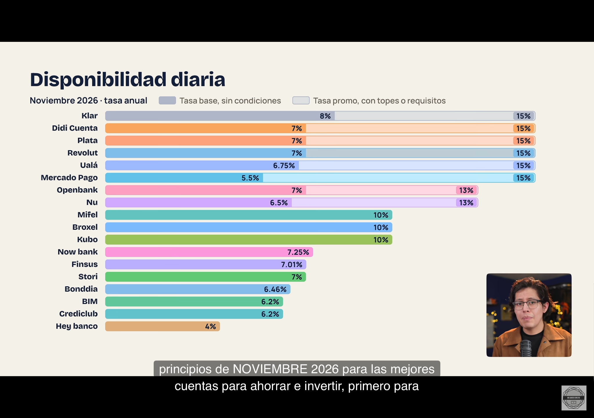

Las finanzas personales son una disciplina que cada persona debe desarrollar y como muchas experiencias en la vida, es algo que solo se aprende a traves de mentoría y conociendo las experiencias de otras personas.

En mi caso, yo comencé a aprender sobre dinero después de pasar momentos difíciles, siempre en el ámbito económico.

## Un poco de historia

Cuando tuve mi primer sueldo, al rededor de unos $1,500.00 MXN mensuales, estaba en la universidad, me había mudado de la casa de mis papás y también me había mudado a otro estado.

Vivía mayormente de la ayuda de mis papás, aun estando lejos de ellos y recibir esos $1,500.00 MXN me quitaba un peso gigante de encima, al final, estaba en la universidad y para mi ese dinero era mucho mas de lo que podia esperar.

Mientras el tiempo pasaba, seguía ganando experiencia y subía en el escalón financiero. Comenzaba a ganar mas dinero a medida de que iba escalando en mi trabajo y me daba cuenta de una cosa, eso que al principio parecía para mi _un mar de dinero_ comenzaba a valer menos, las cuentas subían, los gastos en la casa crecían y parecía que con cada nuevo salto en la escalera financiera no marcaba una diferencia.

Este efecto era curioso, ya que, desde los ojos que alguien que ganaba $1,500.00 MXN, pensaba que su vida iba a estar solucionada si ganase $8,000.00 MXN pesos, pero cuando llegaba a ese objetivo financiero, todo parecía igual; mas tarde descubrí que este efecto se llama ["inflación del estilo de vida"](https://blog.olymptrade.com/es/inflacion-estilo-de-vida/).

> La situación donde uno aumenta sus ganancias seguidas por un aumento en los gastos es muy común. Queremos dinero para tener cosas que realmente no necesitamos. Esa relación entre el crecimiento de los ingresos y el monto de gastos no necesarios nos da un señal de un alto nivel de inflación del estilo de vida.

## Contexto social

¿Han visto el meme de que nuestros padres a los 18 años ya tenían casa, carro y esposa? Ahora también está el de «debí haber comprado una casa en lugar de estar yendo a la primaria». Claro, tenía ocho años, pero aparentemente ahí estuvo mi error.

La ironía tiene que ver con una sensación bastante real para nuestra generación: alcanzar esas mismas metas no se siente igual de accesible. Después de una larga reflexión y unas cuantas cuentas por pagar, entendí que esa realidad para mí no iba a aplicar de la misma forma. Y apareció otra pregunta: ¿qué pasa si los saltos en la escalera financiera se acaban? Peor todavía, ¿qué pasa si empiezan a ir en retroceso?

Cuando escribí la primera versión de este artículo, en 2021, veía a mi papá y a mis abuelos con una pensión que les permitía vivir. Los esquemas de retiro que les correspondieron no son los mismos que nos tocarán a todos nosotros (en el IMSS, los regímenes de la Ley del Seguro Social de 1973 y de 1997). No quiero convertir esto en una discusión política ni simplificar todos los sistemas de pensiones a una sola regla. Mi conclusión personal fue que no podía dar por hecho que alguien más resolvería mi retiro.

Al investigar otros países, me llamó la atención lo integrada que estaba en algunas personas la costumbre de aportar activamente a su futuro. Yo también necesitaba hacer espacio para eso.

## Cuanto gastas, cuanto ganas

Recordando el punto sobre la inflación del estilo de vida, me di cuenta que es un mal vicio que tenia que romper, tenia que volver a tener esa perspectiva de que, podia vivir tranquilamente sin escalar mis gastos al mismo tiempo de escalar mis ingresos.

Para esto es muy importante esclarecer, cuánto gastas en realidad y cuánto ganas; en su momento intente con muchas herramientas o aplicaciones que te ayudaban a medir tus gastos. Hoy en dia muchas apps bancarias también tienen funcionalidades similares, pero lo que mas me ha funcionado es lo mas básico, una hoja de papel (que luego migre a un excel) y enlistar los gastos que eran indispensables, luz, renta, etc.

Con este ejercicio me di cuenta que muchos de mis gastos no aparecían en la lista, por lo que, muchos de mis gastos no eran indispensables. La hoja que luego se convirtió en excel, que fue lo mas conveniente para mi, se convirtió en mi presupuesto, ;a forma de romper con esta inflación del estilo de vida es poniéndole limites.

Una vez definiendo limites, puedes crear un espacio justo, donde puedas destinar este dinero para aportar a tu futuro.

## Deudas

He conocido muchas experiencias de horror, con personas cercanas sobre las deudas y [gran parte de la población en Mexico (y en el mundo) son acreedores de una](https://www.milenio.com/ciencia-y-salud/sociedad/77-poblacion-nacional-deuda-senala-estudio), la realidad es complicada.

Si tu tienes una deuda, no hay una salida fácil y el único camino es enfocarse en pagarla, destinar un gran esfuerzo y trabajo. El mayor problema de la deuda es que se vuelven infinitas a causa de los intereses.

Algunos _bullets_ que podría aconsejar para saldar alguna deuda son:

- Paga primero las que te estén generando mayores intereses.
- Paga de las mas pequeñas, a las mas grandes. esto funciona como un sistema de incentivos.
- Consolida tus deudas en una sola, y solo dedicate a pagar una única deuda. algunos bancos ofrecen reestructuras, pero ojo, revisa el costo total y las consecuencias de cada alternativa, incluidas las quitas y su efecto en tu historial; no todas las opciones son equivalentes.

Una historia que me gusta bastante y de quien aprendí buenos consejos sobre finanzas personales es de [Omar Educación Financiera](https://www.youtube.com/watch?v=Fz7_WvE0HcY), con una historia similar de haber adquirido una gran deuda (+300K), pero que con mucha suerte y esfuerzo pudo transformar a su favor.

## Fondo de emergencias

Nadie esta preparado para una emergencia, eso lo he vivido muchas veces, sea una enfermedad o que se te descomponga el equipo de trabajo o escuela.

Mi papá tenia un carro y muchas fueron las veces en las que ese carro se descomponía y había que buscar formas alternativas de llegar a la escuela o al trabajo; ya que, si no había dinero para la reparación en ese momento, había que esperar.

Las emergencias pueden causar deudas, lo cual es peor, ya que, después de pasar algún mal momento por enfermedad o por reparación de alguna herramienta para trabajar, tienes que pagar una gran cantidad de dinero que posiblemente se estire por varios años.

Muchas veces he escuchado a la gente mencionar qué no les gustan las tarjetas de crédito y estas solo las ven para emergencias, ahí hay un gran error, si no podrás cubrir el total de la emergencia en la siguiente mensualidad de la tarjeta, esta va a generar intereses y considerando que las tasas de interés en Mexico para las tarjetas de crédito van desde 70% hasta el +100%, [una deuda de $10,000.00 se puede convertir en una deuda que tome +20 años en pagar.](https://phpapps.condusef.gob.mx/condusef_pagomin/index.php).

Para estos casos, la mejor estrategia es tener un Fondo de emergencia, una búsqueda rápida en Google te hará saber que un Fondo de emergencia en un dinero puedes ahorrar que represente 3, 6, etc. meses de tus gastos, no confundir con ingresos, recuerda que si tienes un presupuesto y sabes cuando gastas, puedes calcular cuanto necesitas para armar tu fondo.

Los fondos de emergencia usualmente son dinero liquido, dinero que puedes disponer en menos de 24hrs y que te ayudara en estas situaciones.

Una gran estrategia, con el ejemplo de las tarjetas de crédito, es que puedes, si, tener una tarjeta de crédito que cubra tu emergencia al instante, pero como tienes este Fondo al que puedes acceder en menos de 24hrs, podrás pagar en su totalidad o mayoría esta tarjeta.

## Inflación

¿Por qué hay un espacio de 24 horas en ese fondo de emergencia?. Bueno, usualmente como es un dinero que tendrás sin mover hasta el momento de una emergencia, ¿Donde lo pondrías?, fácilmente, se puede guardar en una cuenta de banco o debajo de el colchón, pero descubrirás que puede no ser la mejor idea.

¿Haz visto esas imágenes en Facebook, que muestran una bolsa de Cheetos que solían costar $2.00 MXN?, esas épocas nunca volverán y la razón de esto es la Inflación, esta es, incremento sostenido del costo de los bienes y servicios.

Nuestros padres sabrán perfectamente lo doloroso que es la inflación y nosotros lo vivimos durante 2020 y 2021, cuando escribí la versión original, en el contexto de la pandemia.

Si nosotros hubiéramos guardado estos $2.00 MXN del costo de los Cheetos en la bolsa de un pantalón, al dia de hoy solo tendríamos $2.00 MXN, pero los Cheetos costaran como ~8 veces mas que eso y eso mismo pasaría con nuestro Fondo de emergencias.

## Inversion

El dinero existe para estar en movimiento, para hacer que la economía circule, cuando el dinero esta en movimiento, todos ganamos, cuando hay acumulación la economía sufre.

Yo no creo en el ahorro, ya que lo asocio al estancamiento, un atleta no ahorra energía para prepararse. Invertir puede ser algo subjetivo, puedes invertir en aprender nuevas habilidades, invertir esfuerzos para mejorar la condición física, etc.

El dinero funciona igual, la única forma de mantener tu dinero vivo, es a traves de la inversion, puedes obtener rendimientos por tu dinero en lo que puedes llegar a necesitarlo, ya sea al corto plazo para una emergencia o al largo plazo para tu retiro.

## Tipos de inversiones

Hay varios tipos de inversiones, hay muchos tipos de estafas.

### Estafas

Si tu amigo de la secundaria que no vez en años te habla para proponerte una idea de negocio, o alguien te invita a emprender en un Starbucks, es posible que estes frente a una estafa: ponzi, pirámide, etc.

Cuando comencé a aprender sobre inversiones, lo hice Googleando y el gran problema es que los primeros resultados al buscar "Inversion", suelen ser estafas de este estilo, por lo que hay mucha desinformación y hay que tener mucho cuidado.

NO existe la forma de volverse rico con atajos y en el corto plazo.

### Riesgo

Dependiendo tu perfil como inversionista, vas a tener cierta adversidad al riesgo, existen muchas opciones que usualmente te permiten tener mayor liquidez, protección contra la inflación y un bajo riesgo u otras que te permitan generar rendimientos muy atractivos, pero a su vez, adquiriendo mayor riesgo.

Eso lo decides tu, dependiendo tus necesidades vas a querer adquirir cierto grado de riesgo, pero lo mas común es buscar un balance que te permita cumplir tus objetivos y te haga sentir comodo.

La mejor estrategia siempre es diversificar y _no poner todos los huevos en una sola canasta_.

### Bonos de gobierno

Entre las opciones de menor riesgo crediticio en pesos están instrumentos de deuda del Gobierno federal como los [CETES](https://www.cetesdirecto.com/sites/portal/inicio). En Estados Unidos existen los Treasury Bonds, aunque invertir en otra moneda agrega una variable distinta para quien tiene sus gastos en pesos.

Los CETES suelen ser una puerta de entrada para nuevos inversionistas. No significa que cualquier instrumento de deuda sea idéntico ni que todos estén disponibles inmediatamente. Hay que distinguir el plazo, la disponibilidad del dinero y qué pasa si necesitas vender antes del vencimiento.

En 2021 mencionaba tasas que me parecían atractivas en ese momento. No las dejaría aquí como si fueran una oferta permanente: las tasas cambian y lo importante es comparar el rendimiento, la inflación, los impuestos y las condiciones del producto que realmente vas a contratar.

### La guerra de las tasas

Una de las cosas que más ha cambiado desde que escribí este artículo es la competencia por nuestro dinero. En los años posteriores a 2022 empezamos a ver lo que se conoce como la «guerra de las tasas»: cuentas y productos digitales ofreciendo rendimientos que antes no era tan común encontrar con tanta facilidad.

En esa conversación aparecen nombres como Nu, Mercado Pago, Klar, etcétera. Los nombres y las ofertas cambian muy rápido. Los menciono como referencias para investigar, no como una lista de recomendaciones vigentes ni como si todos fueran la misma clase de institución. «Neobanco» es una etiqueta comercial, no una categoría que por sí sola te diga quién custodia tu dinero, cómo está invertido o qué protección tiene.

La parte interesante es que algunas promociones pueden servir para una porción del dinero que quieres mantener disponible. Pero una tasa grande en un anuncio no cuenta toda la historia. Puede aplicar solo hasta cierto saldo, requerir compras o depósitos, tener una fecha de vencimiento o corresponder a un producto que no puedes retirar de inmediato.

Por eso no repartiría el fondo de emergencia únicamente de mayor a menor tasa. Primero revisaría que pueda usar el dinero cuando lo necesite; después, los límites, las condiciones, la institución que lo recibe y la protección que corresponde a ese producto. Un depósito bancario, uno en una SOFIPO y una inversión en un fondo no son intercambiables.

La idea de distribuir el dinero sí me parece útil: aprovechar un primer tramo en una cuenta y pasar el excedente a otra puede dar un resultado distinto a dejar todo en una sola. Pero hay que hacer la cuenta con los topes reales y con el tiempo que te cuesta administrar varias cuentas. No tiene mucho sentido convertir una mejora pequeña en otro trabajo de tiempo completo.

En el canal de **Mi Amigo Dinero**, en el [video publicado el 4 de noviembre de 2026](https://www.youtube.com/watch?v=7r5S8699SBk), puedes ver esta comparación:

*Fuente: Germán, Mi Amigo Dinero. Captura del video del 4 de noviembre de 2026.*

El color sólido muestra la tasa base y el claro el total promocional: **no se suman**. Es una fotografía de ese momento, no una lista de tasas vigentes. Antes de elegir, revisa los topes, requisitos, protección e impuestos de cada producto.

Si en una conversación pongo como ejemplo diez mil pesos en una cuenta y el resto en otras, es solo eso: un ejemplo. No es una instrucción de inversión ni una garantía de que ese saldo, esa tasa o ese producto sigan disponibles cuando leas esto.

Y hay una comparación que necesita cuidado: una tasa promocional anualizada no es lo mismo que el rendimiento histórico de la Bolsa. Una promoción puede durar semanas o meses; un promedio bursátil resume periodos con subidas y caídas. Que dos anuncios muestren un porcentaje parecido no los convierte en productos equivalentes.

### Bolsa

La Bolsa ha estado muy asociada a grandes capitales y grandes inversionistas. Si hubieras sido amigo de tu papá en su juventud y le hubieras dicho «en lugar de comprar otro terreno, vamos a invertir en la Bolsa», posiblemente te habría respondido que eso era para ricos.

Esa percepción tampoco salió de la nada: las barreras de entrada y la forma de acceder a los servicios financieros eran distintas. Pero no pondría una sola cifra como requisito histórico de todas las casas de bolsa. Cada institución, producto y época ha tenido sus condiciones. La banca privada o patrimonial, además, es un servicio diferente de abrir una cuenta para invertir por tu cuenta.

Lo que sí me interesa rescatar es cuánto se ha simplificado el acceso. La tecnología ha acercado herramientas que antes parecían reservadas a otras personas. Eso no elimina el riesgo, pero sí cambia la idea de que para construir patrimonio necesariamente tienes que empezar comprando una propiedad.

En México existe el [Sistema Internacional de Cotizaciones, o SIC](https://www.bmv.com.mx/es/mercados/mercado-global), que permite acceder a valores extranjeros a través del mercado local. También hay servicios como [Trading USA de GBM](https://gbm.com/faqs/que-es-trading-usa/), con otra vía de operación. Que desde una aplicación puedas comprar empresas como Apple o Alphabet no significa que todas las operaciones se hagan por el mismo mercado, con el mismo intermediario o con el mismo tratamiento fiscal. Antes de contratar, revisa exactamente qué servicio estás usando.

En mi caso, considero que tengo un perfil más orientado a lo moderado. Mi estrategia en Bolsa ha sido invertir principalmente en ETFs mediante aportaciones constantes, mes con mes, con una perspectiva de largo plazo.

He seguido un modelo bastante conocido: invertir en el S&P 500 mediante [VOO](https://investor.vanguard.com/investment-products/etfs/profile/voo), que busca replicar ese índice. A esto le sumo el dollar-cost averaging: invertir una cantidad fija cada mes, tanto cuando el mercado sube como cuando baja, para ir promediando el precio de compra. Soy una persona muy comprometida con mi trabajo y le dedico buena parte de mi tiempo. Esta estrategia me permite no tener que convertir cada aportación en una nueva decisión sobre qué empresa comprar.

Eso no quiere decir que no pueda perder dinero. En la primera versión escribí que «no pierdes hasta que vendes». Es una forma demasiado simple de decirlo: tu inversión sí puede perder valor aunque no la hayas vendido, y no existe la obligación de que vuelva al precio que pagaste. No vender por pánico y negar una pérdida son cosas distintas.

También conviene poner en contexto los rendimientos. Cuando se habla de promedios de alrededor de 10% o 12% anual para el mercado estadounidense, no se está prometiendo ese resultado cada año. Como referencia histórica concreta, la [carta de Berkshire Hathaway de 2024](https://www.berkshirehathaway.com/letters/2024ltr.pdf) presenta un rendimiento compuesto anual del S&P 500, con dividendos, de 10.4% para 1965–2024. Está expresado en dólares nominales y no equivale a mi rendimiento personal, después de impuestos, comisiones, inflación o cambios en el tipo de cambio.

Hay inversionistas que dedican mucho más tiempo al análisis fundamental y al value investing. Warren Buffett es una referencia conocida, pero no tomaría sus resultados como el rendimiento que debería conseguir cualquier persona por estudiar más. Superar a un índice de forma sostenida es muy distinto a tener un buen año.

Tampoco construiría mi plan alrededor de casos extraordinarios. Piensa en un empleado que recibió acciones de una empresa privada, cumplió sus condiciones de vesting y después pudo venderlas cuando la empresa salió a Bolsa. La [salida a Bolsa de SpaceX en 2026](https://ir.spacex.com/updates/releases-details/2026/Space-Exploration-Technologies-Corp--Announces-Closing-of-Initial-Public-Offering-Including-Full-Exercise-of-Underwriters-Option-to-Purchase-Additional-Shares-2026-RgoR-Y1Vwh/default.aspx) sirve para hablar de ese tipo de acontecimientos, no para asumir cuánto ganó cada empleado. El precio de adquisición, las restricciones, los impuestos y el momento de venta importan. No es una experiencia que pueda replicarse comprando cualquier acción.

Para mí, el atractivo de una estrategia sencilla es justamente no depender de acertar con el siguiente caso excepcional. Hay perfiles más agresivos o personas a las que les apasiona el trading, pero no es lo que busco para financiar mi retiro.

El largo plazo ayuda a pensar de otra manera, no garantiza ganancias. Un horizonte de varios años tampoco vuelve seguro el dinero que necesitas para una emergencia próxima. Ese dinero y el de tu retiro tienen trabajos distintos.

### Bienes raíces

Cuando hablaba de inversiones con compañeros cercanos, la respuesta popular eran los terrenos y las casas. Probablemente tiene mucho que ver con nuestro contexto: para nuestros padres, y quizá para sus padres, comprar una propiedad representaba seguridad y progreso. Ese consejo se fue heredando hasta convertirse casi en la definición de patrimonio.

Yo quiero hacer una distinción: comprar una casa para vivir en ella no es lo mismo que comprar una casa para rentarla.

Puedes querer una casa por estabilidad, por hacerla a tu gusto o simplemente porque ahí quieres vivir. Esa decisión no tiene que justificarse únicamente con una tabla de rendimientos. Es un objetivo de vida válido. Lo que no comparto es que tener una propiedad sea el paso obligatorio para demostrar que ya sabes manejar tu dinero.

[Ya había planteado esta postura en LinkedIn](https://www.linkedin.com/feed/update/urn:li:activity:7125273060227575810/): antes de convertir la casa en tu principal objetivo financiero, vale la pena hacer las cuentas. Si necesitas una hipoteca, yo no miraría solamente si alcanza para la mensualidad. También miraría cuánto terminaría pagando entre intereses, seguros, comisiones y otros gastos, y qué margen me quedaría para ahorrar e invertir. Tampoco daría por hecho que la plusvalía compensará cualquier costo del crédito.

Incluso si pudiera comprar de contado, compararía esa opción con seguir rentando y mantener el capital invertido. No porque rentar siempre gane, sino porque usar todo ese dinero en una propiedad significa renunciar a otros usos posibles. Que una inversión alcance para pagar la renta depende del rendimiento después de costos e impuestos, del riesgo que aceptes y de cómo cambie la renta. No basta con dividir un rendimiento anual entre doce: los resultados no son constantes y retirar dinero puede reducir el capital o su poder de compra.

Y tampoco estoy en contra de cualquier hipoteca. Si mis ingresos me permitieran liquidarla pronto, con las condiciones del crédito a favor y sin abandonar mi fondo de emergencia ni mis inversiones, podría tener sentido. Lo que cuestiono es comprometerme durante décadas solo porque eso es lo que se supone que toca hacer. Prefiero elegir con mis propios objetivos y números, no heredar la decisión.

Y cuando se trata de comprar una casa para rentarla, luego otra y después otra, mi postura es distinta. Para mí no es automáticamente la mejor manera de construir riqueza ni un sustituto de un fondo de emergencia. Una propiedad no se convierte en efectivo al momento en que lo necesitas.

Rentar es un negocio: hay que considerar el capital inicial, mantenimiento, reparaciones, periodos sin inquilino, administración, trámites e impuestos. La [CONDUSEF también plantea estos factores al hablar de vivir de las rentas](https://revista.condusef.gob.mx/usuario-inteligente/mito-o-verdad/2021/12/has-pensado-vivir-de-tus-rentas/). El precio de compra y la renta mensual no cuentan toda la historia.

Personalmente, no me gusta dedicar mi tiempo a ese tipo de inversión directa. Me parece burocrática y requiere atención. Además, puedes terminar concentrando gran parte de tu dinero en una sola propiedad. A otras personas sí les gusta ese negocio y pueden encontrar buenas oportunidades; mi desacuerdo es con tratarlo como la mejor opción por defecto para todos.

Si antes parecía que las únicas alternativas eran dejar el dinero en el banco o comprar un terreno, hoy hay más herramientas para comparar. Eso cambia el consejo heredado. Puedes construir patrimonio sin reproducir exactamente el camino de tus papás, ni pelearte con tus tíos por los terrenos del abuelo.

También existen formas de participar en el sector inmobiliario sin comprar una casa completa: plataformas, FIBRAs y vehículos bursátiles. No son lo mismo entre sí ni eliminan el riesgo, pero permiten investigar alternativas con otros tamaños de entrada y formas de administración.

Y hay algo de lo que casi no se habla cuando te recomiendan comprar para rentar: el tratamiento fiscal. No basta con que la renta «pague sola» la hipoteca. Más adelante vuelvo a esto, porque cobrar en efectivo o por transferencia no cambia por sí mismo la naturaleza de tu obligación.

### Divisas

Uno de los consejos financieros que más me choca es «compra dólares», dicho como si por sí solo resolviera el problema de invertir.

Tener una moneda extranjera y tener un activo productivo no son la misma cosa. Si tienes gastos futuros en dólares, conservar una parte en esa moneda puede responder a una necesidad concreta. Otra cosa es comprar billetes esperando que el tipo de cambio siempre juegue a tu favor.

El dólar también pierde poder adquisitivo por la inflación. Además, hay que considerar el tipo de cambio al comprar y vender, las comisiones, la custodia y los impuestos que correspondan. No compararía el dólar con un índice de acciones usando dos porcentajes históricos sin aclarar periodos, moneda, dividendos y costos.

En mi caso prefiero investigar activos productivos dolarizados, como las empresas a las que puedo acceder mediante un ETF, antes que apostar únicamente al movimiento del peso frente al dólar. Eso tampoco elimina el riesgo cambiario ni hace equivalentes todos los instrumentos.

Y la diferencia fiscal no se resume en «dólares malos, Bolsa al 10%». Depende de la operación y de que se cumplan los requisitos legales. Esa es otra razón para entender qué estás comprando antes de mover el dinero.

### Cryptos

Sobre los cryptos, yo creo que, los sistemas descentralizados son el futuro, hay mucho potencial en el De-Fi (Decentralized Finance), pero como método de inversion no lo veo en mi perfil, el riesgo asociado es muy alto y el tratamiento que se le ha dado a las cryptos es en función de Trading.

Pienso que, hay que comenzar a tener una cartera en cryptos a medida de que su adopción va creciendo, creo también, en la idea del Bitcoin, dinero descentralizado que podemos intercambiar por bienes y servicios, sin fronteras y sin una entidad central que la controle.

### Commodities

Hay otros grupos en los que se puede invertir, como el oro, la plata, etc. últimamente también hay cosas como, inversiones en agua, litio, gas natural. Creo que son buenos recursos si quieres agregarlos a tu portafolio, puedes invertir en ellos a traves de ETFs con el mismo tratamiento que se le da a La Bolsa.

Solo no recomendaría invertir directamente en oro o plata como objetos físicos, por el riesgo asociado a protegerlos. La inversion en oro es algo cíclico, como instrumento de protección cuando hay incertidumbre en Las Bolsas, pero puede ser difícil entrar y generar dinero de ello.

## Bancos

En la primera versión dejé a los bancos fuera de los grupos de inversión porque las opciones que estaba comparando no me parecían atractivas frente a la inflación. Con la competencia de tasas ya no usaría esa frase como una regla universal. Compararía el producto concreto, su rendimiento neto y sus condiciones, no únicamente el logotipo.

Un banco también puede ser útil por sus productos de crédito y de pago. Pero tienes que entender cómo funciona el juego: un beneficio pequeño deja de ser atractivo si terminas pagando intereses que lo superan.

Yo uso activamente productos bancarios. Mi consejo personal sigue siendo buscar una tarjeta cuyos beneficios sí te sirvan, como cashback o viajes, y no gastar más por conseguirlos. La intención es pagar lo necesario para no generar intereses, no acostumbrarte al pago mínimo.

Trato de evitar el efectivo. Me resulta más cómodo tener registro de mis operaciones y aprovechar los mecanismos de aclaración. Eso no significa que con una tarjeta de crédito cualquier problema se resuelva a tu favor, ni que con débito sea imposible recuperar un cargo indebido. Hay procedimientos, plazos y condiciones que conviene conocer antes de necesitarlos.

## Impuestos

> En este mundo sólo hay dos cosas seguras: la muerte y pagar impuestos.

Si hay una parte que ampliaría de este artículo, es esta. Tener acceso a una inversión desde el celular no significa que también se haya resuelto su tratamiento fiscal. Antes de contratar hay que entender qué estás comprando, quién interviene, qué retiene y qué te corresponde declarar.

No todos los ingresos ni todos los instrumentos se tratan igual. Intereses, ganancias por venta de acciones, dividendos y rentas pueden tener reglas distintas. Tampoco es correcto resolverlo únicamente diciendo «es una aplicación mexicana» o «el broker está en Estados Unidos».

### La renta y el famoso «si me transfieres te cobro IVA»

A mí me han dicho muchas veces que si pago la renta por transferencia me van a tener que cobrar IVA. Pero el medio de pago no es lo que determina si una renta causa ese impuesto.

La [Ley del IVA contempla la exención para inmuebles destinados o utilizados exclusivamente como casa habitación](https://wwwmat.sat.gob.mx/articulo/39877/articulo-20). Tiene límites: no se aplica de la misma manera al inmueble amueblado ni a hoteles o casas de hospedaje. Un local comercial tampoco se vuelve casa habitación porque su dueño prefiera cobrarlo en efectivo.

Además, que una renta esté exenta de IVA no significa que el ingreso quede libre de ISR. Son preguntas distintas. Cobrar en efectivo no borra la obligación de declarar; tampoco demuestra, por sí solo, que alguien esté evadiendo. El problema aparece cuando se usa el efectivo para ocultar ingresos que debían reportarse.

Por eso, antes de comprar una propiedad para rentarla, investigaría sus obligaciones reales. No me quedaría con «el inquilino paga y ya». Si la cuentas como inversión, los impuestos forman parte de la cuenta.

### Plataformas y actividades económicas

Si ofreces alojamiento mediante Airbnb, transportas personas con Uber o vendes a través de Mercado Libre, necesitas identificar las reglas aplicables a esa actividad y a tu situación. No existe necesariamente un régimen independiente por cada marca de aplicación.

Las plataformas pueden efectuar retenciones, pero una retención no siempre significa que ya terminaste de cumplir. La [LISR contempla condiciones para optar por pagos definitivos en determinados casos de ingresos mediante plataformas](https://wwwmatnp.sat.gob.mx/articulo/06718/articulo-113-b). Si no cumples las condiciones, el tratamiento puede ser distinto. Aquí sí vale la pena consultar tu caso con alguien que conozca esa actividad.

### Invertir también exige llevar cuentas

La Bolsa no es una sola categoría fiscal. Para determinadas ganancias por enajenación de acciones hay un régimen de 10%, sujeto a los requisitos legales. No es una tasa universal para dividendos, intereses o cualquier cosa que puedas comprar desde una app.

Tampoco se puede afirmar que operar mediante un intermediario extranjero siempre lleva esas ganancias a una tarifa progresiva. Importan el instrumento, el mercado y las condiciones aplicables, incluidas las relativas al SIC. El [SAT recoge criterios al respecto en el Anexo 7 de la RMF 2026](https://sat.gob.mx/minisitio/NormatividadRMFyRGCE/documentos2026/rmf/anexos/Anexo_7_RMF2026-09012026.pdf).

Antes de abrir otra cuenta, yo revisaría qué constancias o reportes entrega, cómo identificar ganancias y dividendos, qué impuestos retiene y cuáles tendré que calcular o declarar por mi cuenta. Que una app facilite comprar no necesariamente significa que facilite todo lo demás.

### ¿Cuándo toca presentar declaración anual?

No existe una lista de tres reglas que sirva igual para todas las personas físicas. Una persona asalariada y alguien con actividad empresarial no parten de las mismas obligaciones.

Para quienes reciben salarios, el [SAT enumera supuestos como superar $400,000 de ingresos anuales, tener dos o más patrones simultáneamente y obtener otros ingresos acumulables además del salario](https://www.sat.gob.mx/minisitio/DeclaracionAnual/Personas/quienes_deben_presentarla.html), junto con otros casos y facilidades que hay que revisar. No basta con leer el monto o recordar que cambiaste de trabajo para concluir cómo aplica a tu situación.

Si tienes actividad empresarial, servicios profesionales, arrendamiento, inversiones u otros ingresos, revisa las obligaciones específicas de tu régimen y la combinación de ingresos. No diría que cualquier inversión, por pequeña que sea y sin importar su tratamiento, obliga automáticamente a presentar anual.

Y aun cuando exista una facilidad o no estés obligado en un supuesto concreto, conviene entender si puedes presentar una declaración y aprovechar deducciones personales que realmente te correspondan. Consultas médicas, lentes o colegiaturas tienen requisitos y límites; no todo gasto relacionado con ellos es deducible sin más.

Sigo pensando que aprender a hacer la declaración es útil. Lo que no prometería es que todos los casos se resuelven en diez minutos o que siempre habrá saldo a favor. Si la situación ya mezcla varios tipos de ingresos, buscar ayuda no es un fracaso: es parte de administrar bien el dinero.

## AFORE y planes personales de retiro

Vuelvo al tema que abrió buena parte de esta reflexión: el retiro.

Conoce dónde está tu AFORE, revisa tu información y compara las condiciones aplicables antes de elegir o cambiar de administradora. También verifica que tu salario esté registrado correctamente. No conviene descubrir demasiado tarde que las aportaciones no correspondían a lo que creías.

En 2021 escribí que no recomendaría aportaciones voluntarias porque prefería el rendimiento de la Bolsa. Hoy no lo dejaría como una comparación automática: no se pueden aislar los rendimientos de las comisiones, los impuestos, los plazos, el riesgo y las reglas para disponer del dinero.

Algo que también ha ganado presencia en las conversaciones sobre retiro son los PPR, o planes personales de retiro. El beneficio fiscal puede ser atractivo, pero no convierte a todos los planes en buenos productos ni hace que todos funcionen igual.

En los planes que cumplen los requisitos del artículo 151, la [deducción tiene como límite el menor entre 10% del ingreso acumulable anual y cinco UMA anuales](https://sat.gob.mx/minisitio/DeduccionesPersonales/aportaciones_complementarias.html). Esa vía tiene condiciones de permanencia, asociadas a los 65 años o a los supuestos de invalidez o incapacidad previstos. Deducir una aportación no significa recibir de regreso toda esa cantidad.

Lo que me preocupa son las letras chiquitas. Una comisión anual puede parecer pequeña cuando la ves aislada, pero su efecto se acumula durante décadas. También puede haber costos de los fondos, coberturas de seguro, compromisos de aportación, penalizaciones o restricciones de retiro. Hay que revisar cuáles existen en el contrato concreto, no suponer que todos los PPR los tienen.

Como ejemplo de que las comisiones deben leerse producto por producto, [Fintual publica para su PPR una comisión de 1% anual más IVA sobre el saldo](https://ayuda.fintual.mx/es/articles/8225935-cual-es-la-comision-del-ppr). Es una referencia para entender qué comparar, no un costo universal ni una recomendación de contratarlo. Hay que consultar la tarifa vigente y los demás costos que pudieran aplicar.

Antes de decidir, yo pediría una comparación después de todos los costos e impuestos, con supuestos equivalentes, y preguntaría qué pasa si dejo de aportar, cambio de plan o necesito el dinero antes. No compraría el producto solo por la devolución de la próxima declaración.

Mi postura no es que un PPR sea malo por definición. Yo lo veo como un complemento puntual, no como la primera respuesta automática a cualquier pregunta sobre retiro. Me interesa especialmente cuando el ahorro fiscal es relevante, puedes aprovechar la aportación deducible que te corresponda y también vas a reinvertir ese ahorro.

El límite deducible es un techo, no una obligación de aportar hasta él. Tampoco basta con estar en una tasa marginal superior al 30% para concluir que conviene: esa cifra sería una hipótesis para analizar, no una frontera universal. Importan la tasa marginal realmente aplicable a cada parte de la deducción, las comisiones, el tiempo restante, qué compras dentro del plan y cómo retirarás el dinero.

Lo que quiero comparar es cuánto conservas al final con el mismo esfuerzo de aportación: una inversión directa y una inversión mediante PPR, reinvirtiendo el ahorro fiscal cuando exista. Si el PPR cobra sobre el saldo, el costo en pesos puede crecer con el patrimonio y reducir una ventaja inicial. Pero no puedo dar por hecho que siempre exista un año a partir del cual pierda. Hay que calcularlo para ese producto y esos supuestos.

También importa si reinviertes la devolución, si vuelves a aportarla al PPR o si la colocas fuera. No es el mismo escenario. Y si retiras antes de cumplir las condiciones, hay [consecuencias fiscales que deben revisarse](https://wwwmat.sat.gob.mx/articulo/49469/articulo-142); una retención no debe confundirse automáticamente con una multa definitiva.

### Un ejemplo para ponerle números

Quería revisar una idea que ya había calculado antes: ¿el ahorro fiscal alcanza a compensar lo que te cuesta el plan durante tantos años?

Imaginemos una sola aportación de **$100,000**, no cien mil cada año. En ambos caminos suponemos **8% anual bruto**, constante solo para hacer la cuenta, y **0.03% anual de costo del ETF**. Al PPR le agregamos **1.16% anual sobre el saldo**. Es un escenario de costos, no la afirmación de que un PPR concreto pueda comprar exactamente el mismo ETF.

En el camino del PPR suponemos un ahorro fiscal efectivo de **$30,000**, recibido un año después y reinvertido fuera del PPR, en el ETF. No lo gastas ni lo contamos dos veces como una nueva deducción.

Deducir esos $100,000 completos por esta vía requiere, entre otras condiciones, un ingreso acumulable anual de al menos un millón de pesos y respetar el límite de cinco UMA anuales. Los $30,000 de ahorro son otro supuesto: tu devolución real no se obtiene automáticamente multiplicando toda la aportación por la tasa más alta de tu recibo.

Para comparar saldos después de una venta, aplicamos un **10% hipotético sobre la ganancia del ETF** y suponemos **cero impuesto de salida del PPR**. Esto último depende de cumplir requisitos y límites de exención: no está garantizado para cualquier saldo ni forma de retiro. Las filas tampoco representan un permiso de retirar antes de los 65 años sin consecuencias.

| Años desde la aportación | Inversión directa, neta | PPR + ahorro fiscal reinvertido, netos |
| --- | ---: | ---: |
| 10 | $203,700 | $248,400 |
| 20 | $427,000 | $485,700 |
| 30 | $907,500 | $955,100 |
| 40 | $1,941,900 | $1,885,800 |

En este escenario la ventaja inicial del PPR dura muchos años, pero la inversión directa termina superándola alrededor del **año 37**. El beneficio fiscal llega en un momento concreto; la comisión sobre el saldo se sigue cobrando.

Cambia los supuestos y cambia la conclusión. Con ahorro fiscal efectivo de 20%, manteniendo lo demás igual, el cruce aparece alrededor del año 26. Si conservas el ahorro de 30% pero el costo adicional del PPR sube a 2% anual, aparece alrededor del año 21. No son edades recomendadas de salida ni reglas para contratar.

Aquí no hay aportaciones posteriores, inflación, variaciones del mercado ni una simulación fiscal completa. Tampoco estamos comparando carteras reales de productos distintos. Aportar cada año, reinvertir la devolución dentro del PPR, pagar otros costos o tener impuestos al retirar puede cambiar sustancialmente el resultado.

No me quedaría con «el PPR siempre conviene» ni con «después de tantos años siempre pierde». La pregunta útil es si, con **tu** ahorro fiscal, horizonte, costos y forma de retirar, te deja más dinero que una alternativa comparable. Yo lo veo como un complemento que hay que calcular, no como requisito para empezar a invertir para el retiro.

Este ejemplo es una comparación educativa condicionada, no una recomendación individual. Antes de aplicarlo a un caso real, hay que revisar profesionalmente los impuestos y las condiciones de retiro.

La idea no es rechazar una herramienta útil. Es no dejar que el beneficio de la próxima declaración esconda lo que pagarás durante décadas. Tu dinero para el retiro merece algo más de atención que la presentación de ventas.

## Conclusiones y últimos consejos personales

Recuerda que esto es lo que yo he aprendido en mi vida como trabajador, me gusta seguir disfrutando de mis proyectos y aspirar a tener un retiro digno, recuerda que lo que puedes estar ganando hoy, no sera lo mismo que ganes a la edad de 65 años.

Estos no son consejos de inversion y no tienes que tomar mis opiniones como tuyas, son una guiá para que puedas investigar lo que mas te favorece, por que cuando comencé, la información era confusa y habrá muchas trampas en el camino.
